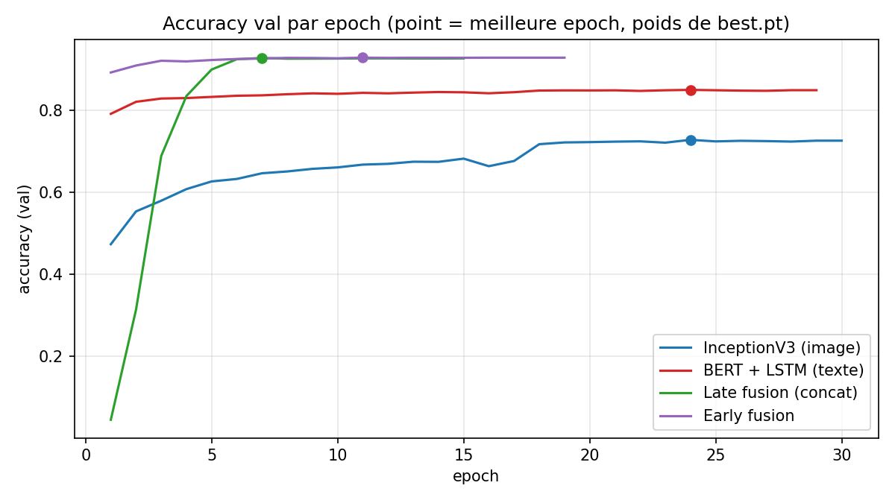
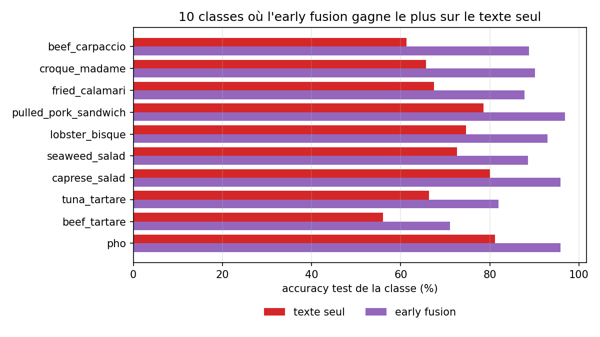

# UPMC Food-101 : fusion image + texte (reproduction PyTorch)

Reproduction en PyTorch de **Gallo et al., IVCNZ 2020**,
*« Image and Text fusion for UPMC Food-101 using BERT and CNNs »*.

Le but est de classer 101 plats à partir d'une **photo** et du **titre de la page web** d'où elle
vient. On entraîne d'abord deux modèles séparés :

- **image** : InceptionV3 pré-entraîné sur ImageNet (Table I de l'article) ;
- **texte** : BERT-base + LSTM (Table II).

Puis on les combine par *stacking*, de deux façons :

- **late fusion** : un MLP sur les deux vecteurs softmax (Table III) ;
- **early fusion** : un MLP sur les features internes des deux modèles (Table IV).

L'entraînement tourne sur des GPU [Modal](https://modal.com). Les données viennent de Kaggle.

---

## Structure du dépôt

```
src/
  split.py          # découpage stratifié train/val (90/10) + test officiel -> /data/splits/*.csv
  data.py           # FoodDataset (modes image | text | both), transforms, nettoyage + tokenisation des titres
  models/
    image.py        # ImageClassifier : InceptionV3 + tête Table I (+ classifieur auxiliaire)
    text.py         # TextClassifier : BERT -> LSTM(128) "packé" -> tête Table II
    fusion.py       # LateFusion (Table III, 4 modes de fusion) et EarlyFusion (Table IV)
  train.py          # boucle générique : AMP, log JSON par epoch, best.pt / last.pt, reprise, LR sur plateau
  extract.py        # cache des features : softmax + features image/texte pour train/val/test
  train_fusion.py   # entraînement des fusions sur les features en cache, test évalué une seule fois
  examples.py       # copie d'exemples de test pour l'analyse d'erreurs
modal_app.py        # plomberie Modal : image Docker, volumes, secrets, une fonction par étape
configs/            # un YAML par étape (aucun hyperparamètre écrit en dur dans le code)
notebooks/
  analysis.ipynb    # figures, tables vs article, analyse d'erreurs (ne fait aucun entraînement)
results/            # petits fichiers seulement : JSON de métriques, CSV, figures PNG
```

Le stockage sur Modal se fait dans deux volumes :

| volume | monté sur | contenu |
|---|---|---|
| `food101-data` | `/data` | images, titres, `splits/{train,val,test}.csv` |
| `food101-ckpt` | `/ckpt` | checkpoints (`image/`, `text/`, `late_*/`, `early/`), `features/`, `results/`, `examples/` |

Les données, les checkpoints, les fichiers `.pt` et les secrets ne sont **jamais** commités
(voir `.gitignore`).

---

## Installation

### 1. Environnement local

Le calcul tourne sur Modal. En local, il faut seulement le client Modal et de quoi lancer le
notebook :

```bash
python3.12 -m venv food101
source food101/bin/activate
pip install modal pandas matplotlib jupyter
modal setup                      # connecte le client à ton compte Modal
```

Les dépendances d'entraînement (torch, torchvision, transformers, scikit-learn, kaggle…) sont
installées **dans l'image Modal**, avec des versions fixées dans `modal_app.py`.

### 2. Secrets Modal

Les clés sont stockées dans Modal, jamais dans le dépôt.

```bash
# Kaggle : téléchargement du dataset (kaggle.com > Settings > API > Create New Token)
modal secret create kaggle-secret KAGGLE_USERNAME=<ton_user> KAGGLE_KEY=<ta_clé>

# Hugging Face : téléchargement de bert-base-uncased (huggingface.co > Settings > Access Tokens, type "Read")
modal secret create huggingface-secret HF_TOKEN=hf_xxxxxxxx
```

`transformers` lit `HF_TOKEN` tout seul. Seules les fonctions qui téléchargent BERT reçoivent ce
secret.

---

## Commandes, phase par phase

Toutes les commandes se lancent depuis la racine du dépôt, avec le venv activé. Ajoute `--detach`
aux longues commandes pour qu'elles continuent si ton ordinateur se met en veille.

### Phase 0 : vérifications et données

```bash
modal run modal_app.py::check_env        # GPU visible, versions des bibliothèques
modal run modal_app.py::download_data    # Kaggle -> /data (une seule fois ; --force pour retélécharger)
modal run modal_app.py::inspect_data     # arborescence, aperçu des CSV, nombre d'images par split
modal run modal_app.py::split_data       # train 61 174 / val 6 798 / test 22 716, stratifié, seed 42
```

### Phase 1 : tests rapides (formes des tenseurs, boucle)

```bash
modal run modal_app.py::test_data          # un batch par mode, affiche les formes
modal run modal_app.py::test_image_model   # (2,3,299,299) -> logits (2,101), features (2,2048)
modal run modal_app.py::test_text_model    # logits (2,101), features (2,128), test du packing
modal run modal_app.py::test_train         # modèle jouet : 2 epochs, puis reprise depuis last.pt
```

### Phase 2 : modèles unimodaux (GPU)

```bash
modal run modal_app.py::train_image --smoke            # 2 epochs sur 500 images, pour vérifier
modal run --detach modal_app.py::train_image           # InceptionV3, 30 epochs
modal run --detach modal_app.py::train_text            # BERT + LSTM, jusqu'à 40 epochs (early stopping)
```

Relancer la même commande **reprend** l'entraînement depuis `/ckpt/<run>/last.pt`.

### Phase 3 : cache des features (GPU)

```bash
modal run modal_app.py::extract_features --smoke       # 500 lignes par split -> /ckpt/features_smoke
modal run --detach modal_app.py::extract_features      # best.pt image + texte -> /ckpt/features/{train,val,test}.pt
```

Options : `--image-ckpt` et `--text-ckpt` (autre checkpoint), `--splits val,test` (un sous-ensemble
des splits). Chaque fichier enregistre de quels checkpoints il vient. Les étapes de fusion
préviennent si les splits ne viennent pas des mêmes checkpoints.

### Phase 4 : fusions (CPU, quelques minutes chacune)

```bash
modal run modal_app.py::eval_baselines                 # image seule, texte seul, (p_img + p_txt)/2
modal run modal_app.py::train_late --merge concat      # late fusion, Table III
modal run modal_app.py::train_late --merge sum
modal run modal_app.py::train_late --merge max
modal run modal_app.py::train_late --merge weighted
modal run modal_app.py::train_early                    # early fusion, Table IV (seed 42)
modal run modal_app.py::train_early --seed 1           # seeds supplémentaires -> early_seed1.json
modal run modal_app.py::train_early --seed 2
```

### Phase 5 : analyse

```bash
modal run modal_app.py::export_examples                # 4 images par cas d'erreur + titres -> /ckpt/examples
modal volume get food101-ckpt results results/         # JSON, CSV de prédictions
modal volume get food101-ckpt examples results/        # exemples pour le rapport
jupyter notebook notebooks/analysis.ipynb
```

Le notebook trouve les résultats dans `results/` ou dans `results/results/`. Ce second dossier
apparaît quand `modal volume get` copie vers un `results/` qui existe déjà.

---

## Résultats

Accuracy sur le **test officiel** (22 716 échantillons). Chaque modèle est évalué **une seule fois**,
avec les poids de sa meilleure epoch sur la **validation**.

### Table VII : comparaison des modèles

| modèle | nous | article | écart |
|---|---|---|---|
| Images (InceptionV3) | 72,16 % | 71,67 % | +0,49 |
| Texte (BERT + LSTM) | 85,38 % | 84,41 % | +0,97 |
| Late fusion (concat) | **92,72 %** | 84,59 % | **+8,13** |
| Early fusion | 92,70 % | 92,50 % | +0,20 |

Early fusion sur 3 seeds : *à compléter* (pour l'instant, seulement la seed 42). Après les deux
commandes `train_early --seed 1` et `--seed 2`, la section 7 du notebook calcule la
moyenne ± écart-type.

### Table VI : stratégies de late fusion

| fusion | nous (acc / loss) | article (acc / loss) |
|---|---|---|
| Sum | 93,10 % / 0,43 | 79,40 % / 1,24 |
| Maximum | 92,78 % / 0,46 | 79,19 % / 2,08 |
| Weighted Ensemble (α appris = 0,54) | 88,30 % / 3,31 | 84,58 % / 1,00 |
| Concatenation | 92,72 % / 0,69 | 84,59 % / 1,01 |
| *Moyenne `(p_img + p_txt)/2`, sans entraînement* | *93,91 %* | — |

### Analyse d'erreurs (early fusion, test)

| cas | % du test |
|---|---|
| image fausse / fusion juste | 22,80 % |
| texte faux / fusion juste | 8,32 % |
| image et texte faux / fusion juste | 0,57 % |
| image et texte justes / fusion fausse | 0,03 % |

Par rapport au texte seul, la fusion corrige 1 889 erreurs et en introduit 225 : +7,33 points net.
Les confusions les plus fréquentes sont sashimi ↔ sushi, beef_tartare ↔ tuna_tartare et
dumplings ↔ gyoza.

### Figures

Accuracy de validation par epoch des 4 modèles (équivalent de la Fig. 4 ; le point marque l'epoch
retenue) :



Les 10 classes où l'early fusion gagne le plus sur le texte seul :



---

## Différences avec l'article

Les choix pris là où l'article ne dit rien sont aussi marqués `# CHOICE:` dans le code et les configs.

**Protocole d'évaluation**

- **Validation séparée.** Nous découpons le train officiel en 90 % train et 10 % validation, avec un
  tirage stratifié par classe et la seed 42. Toutes les décisions se prennent sur cette validation :
  meilleure epoch, baisses de LR, early stopping. L'article prend ces décisions sur le **test** : sa
  Fig. 4 trace l'accuracy test par epoch, et la LR de l'early fusion baisse « quand le test ne
  s'améliore plus ». Notre test ne sert qu'aux chiffres finaux, et notre Fig. 4 trace donc la
  validation.
- **Moins d'images d'entraînement.** Nos modèles voient 61 174 images, contre 67 988 dans l'article.
  Les 16 images d'entraînement sans titre sont écartées.

**Modèle image (Table I)**

- **Classifieur auxiliaire.** Le classifieur auxiliaire d'InceptionV3 est conservé pendant
  l'entraînement, avec un poids de 0,4 sur sa loss. L'article ne le mentionne pas.
- **Augmentations non précisées dans l'article.** En entraînement : `RandomResizedCrop(299)` et
  retournement horizontal. En évaluation : redimensionnement à 342 puis recadrage central à 299.
- **Réglages de l'optimiseur.** Nous utilisons SGD avec un momentum de 0,9, valeur que l'article ne
  donne pas. La LR suit la liste de l'article, `0,01 → 0,001 → 0,0005`. Comme il ne dit pas quand
  la baisser, nous passons à la valeur suivante après 2 epochs sans progrès sur la validation. Nous
  entraînons 30 epochs, un nombre que l'article ne donne pas non plus.

**Modèle texte (Table II)**

- **BERT gelé.** BERT sert d'extracteur de features : seuls le LSTM et la tête sont entraînés.
  L'article ne précise pas ce point ; sa LR de 1e-3 avec Adam laisse penser à un BERT gelé.
- **Titres nettoyés.** On décode les entités HTML et on retire l'enveloppe `[["…"]]` présente sur
  environ 4 % des titres. Les titres sont tronqués à 64 tokens.
- **Padding ignoré par le LSTM.** Les séquences sont « packées » (`pack_padded_sequence`), et la
  feature retenue est l'état caché au dernier vrai token.
- **Réglages de l'optimiseur.** Adam avec une LR de 1e-3, réduite par un facteur 0,1 après 2 epochs
  sans progrès (`ReduceLROnPlateau`). Arrêt après 5 epochs sans progrès. L'article ne donne ni le
  facteur, ni la patience.

**Fusions (Tables III et IV)**

- **Stacking sur features en cache.** Les modèles de base sont figés. Leurs sorties sont calculées
  une fois pour chaque split, sans augmentation, puis les têtes de fusion sont entraînées sur ces
  sorties. Les têtes apprennent donc sur les softmax et les features du **train**, que les modèles
  de base connaissent déjà.
- **Modes de late fusion.** Nous avons implémenté sum, max, weighted et concat, mais pas la
  multiplication que l'article mentionne. En mode *weighted*, le mélange vaut
  `α·p_img + (1−α)·p_txt`, avec α un scalaire appris borné par une sigmoïde et initialisé à 0,5.
- **Branche image de l'early fusion.** Elle enchaîne Dropout 0,4, une couche dense
  2048 → 128 et une ReLU. L'article ne donne pas l'activation de cette couche.
- **Réglages de l'optimiseur.** SGD avec une LR qui suit `0,01 → 0,001 → 0,0001` (Section V), avec
  un momentum de 0,9 que l'article ne donne pas. Nous entraînons 20 epochs pour la late fusion et 30
  pour l'early fusion, avec un arrêt après 8 epochs sans progrès.

**Résultats**

- **Notre late fusion est bien meilleure.** Elle atteint 92,7 % contre 84,6 % dans l'article, et
  elle est au niveau de l'early fusion. Dans l'article, la late fusion n'apporte presque rien par
  rapport au texte seul. L'article ne donne pas assez de détails sur l'entraînement de sa tête de
  late fusion pour expliquer l'écart.
- **Une simple moyenne fait mieux que toutes les fusions entraînées.** La moyenne des deux softmax,
  sans entraînement, atteint 93,91 %. Une explication possible : les têtes de fusion apprennent sur
  des softmax du train trop confiantes, alors que la moyenne ne dépend pas de ces sorties.
- **Le mode weighted est le plus faible de nos modes** : 88,3 %, avec une loss test élevée.

**Technique**

- PyTorch au lieu de Keras.
- Entraînement en précision mixte (float16) sur des GPU L4, A10G ou T4 via Modal, contre un P100 sur
  Colab dans l'article.
- Seed 42 pour tout. L'écart-type sur 3 seeds ne mesure que la tête d'early fusion : les modèles de
  base ne sont pas ré-entraînés.
